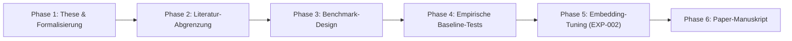

# Master-Fahrplan & To-Do-Liste zum Paper

> **Projekt:** Lingual Composite Learning  
> **Ziel:** Veröffentlichung eines referierten wissenschaftlichen Papers (Autor: Sebastian Oertel).  
> **Stand:** 31. Oktober 2026

---

## 🗺️ Die 6 Phasen zum Paper

---

## 📋 Phasenspezifisches Backlog

### Phase 1: These, Ontologie & Begriffs-Fundierung (In Vertiefung)
- [x] Zentrale Forschungsthese geschärft (*The Latent Semantic Bottleneck Hypothesis* in [`HYPOTHESES.md`](file:///c:/workspace/Experimental/LingualCompositLearning/dev/HYPOTHESES.md)).
- [x] Formalisierung von Konzepten als Tupel $C = \langle \mathcal{T}_C, \mathcal{I}_C, \pi_C, \mathcal{S}_C \rangle$.
- [x] Definition der Teilhypothesen H1 (Inferenz), H2 (Robustheit), H3 (Kompression), H4 (Kompositionalität).
- [ ] **TODO-1.1:** Wissenschaftliche Fundierung des Begriffssystems (keine Dada-Wörter, sondern Kognitionslinguistik & Regelungstheorie gem. [`FOUNDATION_ROADMAP.md`](file:///c:/workspace/Experimental/LingualCompositLearning/dev/FOUNDATION_ROADMAP.md)).
- [ ] **TODO-1.2:** Morphologische Architektur & Tokenizer-Parität für Neologismen.
- [ ] **TODO-1.3:** Kanonischer Start-Katalog (Vokabular v1.0 mit formalen Steckbriefen).

### Phase 2: Literatur-Abgrenzung & State-of-the-Art Matrix (In Arbeit)
- [x] Initial-Exzerpte zu Hewitt (2025/2026), Lupyan (2007) und Yang (2024).
- [ ] **TODO-2.1:** Differenzierungs-Matrix erstellen: Präzise Abgrenzung zu *Hierarchical Reinforcement Learning (Options)* und *Concept Bottleneck Models (CBM)* in [`literature/differentiation_matrix.md`](file:///c:/workspace/Experimental/LingualCompositLearning/dev/literature).
- [ ] **TODO-2.2:** Ziel-Venues definieren (z. B. ICLR 2027, EMNLP 2026/2027 oder HRI 2027).

### Phase 3: Benchmark & Evaluierungs-Harnisch (Erledigt)
- [x] 10 standardisierte Test-Szenarien mit harten Zielkonflikten entworfen ([`data/benchmarks/benchmark_v1.json`](file:///c:/workspace/Experimental/LingualCompositLearning/dev/data/benchmarks/benchmark_v1.json)).
- [x] Quantitativer Evaluator für Invariant Recall und Violations implementiert ([`src/lingual_research/evaluator.py`](file:///c:/workspace/Experimental/LingualCompositLearning/dev/src/lingual_research/evaluator.py)).
- [x] Experiment-Runner für 3 Versuchsbedingungen gebaut und per Trockenlauf getestet ([`src/lingual_research/runner_exp001.py`](file:///c:/workspace/Experimental/LingualCompositLearning/dev/src/lingual_research/runner_exp001.py)).

### Phase 4: Empirische Baseline-Experimente auf lokaler RTX 5090
- [x] **TODO-4.1:** Lokaler Download von `Qwen/Qwen2.5-14B-Instruct` (27.65 GB VRAM auf RTX 5090).
- [x] **TODO-4.2:** Durchführung von EXP-001 Pilot (Bedingung A vs. B vs. C) über 10 Szenarien.
- [x] **TODO-4.3:** Statistische Auswertung & Dokumentation der Befunde ([`findings/FINDINGS-EXP-001.md`](file:///c:/workspace/Experimental/LingualCompositLearning/dev/findings/FINDINGS-EXP-001.md)).
- [x] **TODO-4.4 (Skalierung):** Benchmark auf 100 Szenarien über 4 Domänen erweitert ([`data/benchmarks/benchmark_v2.json`](file:///c:/workspace/Experimental/LingualCompositLearning/dev/data/benchmarks/benchmark_v2.json), Spezifikation in [`data/benchmarks/BENCHMARK_V2_SPEC.md`](file:///c:/workspace/Experimental/LingualCompositLearning/dev/data/benchmarks/BENCHMARK_V2_SPEC.md)).
- [ ] **TODO-4.5:** Durchführung des großen Benchmark-Laufs **EXP-002** (100 Szenarien x 3 Bedingungen = 300 Inferenz-Durchläufe auf RTX 5090) zur Berechnung von $p$-Werten und Konfidenzintervallen.
- [ ] **TODO-4.6 (Compute Parity):** Two-Stage Baseline ohne Konzepte evaluieren.

### Phase 5: Soft-Token / Embedding Tuning (EXP-002)
- [ ] **TODO-5.1:** Echte neue Konzept-Token (`<|fufu|>`, `<|weli|>`, `<|zubu|>`) als trainierbare Vektoren in Qwen-14B einbinden (PEFT / LoRA Soft Prompting auf RTX 5090).
- [ ] **TODO-5.2:** Nachweis, dass das Modell ohne Text-Prompting direkt auf das Token konditioniert werden kann (Attraktor im Latent Space).
- [ ] **TODO-5.3 (Ablations-Studie):** Neologismus (`<|fufu|>`) vs. Naturalsprachliches Token (`[SAFETY_STANDOFF]`) testen.

### Phase 6: Paper-Manuskript & Veröffentlichung
- [ ] **TODO-6.1:** Manuskript-Outline in LaTeX / Markdown aufsetzen ([`papers/`](file:///c:/workspace/Experimental/LingualCompositLearning/dev/papers)).
- [ ] **TODO-6.2:** Einleitung, Verwandte Arbeiten und Methodik schreiben.
- [ ] **TODO-6.3:** Experiment-Kapitel mit Diagrammen und statistischen Signifikanzwerten befüllen.
- [ ] **TODO-6.4:** Peer-Review-Selbstprüfung (Red-Teaming des Papers gegen kritische Reviewer-Argumente).
