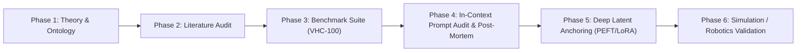

# Master Roadmap & Publication Backlog

> **Project:** Lingual Composite Learning  
> **Objective:** Empirical investigation of deeply anchored concept-composite tokens for embodied agent and robot coordination (Author: Sebastian Oertel).  
> **Status:** Phase 1–4, 6 Concluded with Adversarial Red-Team Audit (Score: 2/10 — Strong Reject). In-context prompt-routing transitioned to Open-Science Post-Mortem. Phase 5 (PEFT/LoRA Latent Anchoring) is Active Frontier.  

---

## 🗺️ The 6 Research Phases

---

## 📋 Phase-Specific Backlog

### Phase 1: Thesis, Ontology & Concept Foundation (Completed)
- [x] Core research hypothesis formulated (*The Latent Semantic Bottleneck Hypothesis* in [`HYPOTHESES.md`](file:///c:/workspace/Experimental/LingualCompositLearning/dev/HYPOTHESES.md)).
- [x] Formalization of concepts as tuples $C = \langle \mathcal{T}_C, \mathcal{I}_C, \pi_C, \mathcal{S}_C \rangle$.
- [x] Definition of sub-hypotheses H1 (Inference), H2 (Robustness), H3 (Compression), H4 (Compositionality).
- [x] Grounding in cognitive linguistics & control theory ([`concepts/SEMANTIC_DIMENSIONS.md`](file:///c:/workspace/Experimental/LingualCompositLearning/dev/concepts/SEMANTIC_DIMENSIONS.md)).
- [x] Morphological architecture & tokenizer parity for neologisms ([`concepts/MORPHOLOGY_AND_SYNTAX.md`](file:///c:/workspace/Experimental/LingualCompositLearning/dev/concepts/MORPHOLOGY_AND_SYNTAX.md)).
- [x] Canonical starter catalog (Vocabulary v1.0 in [`concepts/VOCABULARY_V1.md`](file:///c:/workspace/Experimental/LingualCompositLearning/dev/concepts/VOCABULARY_V1.md)).

### Phase 2: Literature Differentiation & State-of-the-Art (Completed)
- [x] Literature survey on Hewitt (2025/2026), Lupyan (2007), and Yang (2024).
- [x] Differentiation matrix established against *HRL (Options)*, *CBMs*, and *Constitutional AI* in [`literature/differentiation_matrix.md`](file:///c:/workspace/Experimental/LingualCompositLearning/dev/literature/differentiation_matrix.md).
- [x] Deep Literature Audit (2024–2026) regarding unfaithful CoT and embodied robotics benchmarks ([`literature/DEEP_LITERATURE_AUDIT_2026.md`](file:///c:/workspace/Experimental/LingualCompositLearning/dev/literature/DEEP_LITERATURE_AUDIT_2026.md)).

### Phase 3: Benchmark & Evaluation Suite (Completed)
- [x] VHC-100 Benchmark Suite with 100 adversarial scenarios across 4 domains ([`data/benchmarks/benchmark_v2.json`](file:///c:/workspace/Experimental/LingualCompositLearning/dev/data/benchmarks/benchmark_v2.json)).
- [x] Quantitative evaluator with bilingual stem matching and negation safeguards ([`src/lingual_research/evaluator.py`](file:///c:/workspace/Experimental/LingualCompositLearning/dev/src/lingual_research/evaluator.py)).
- [x] Independent LLM-as-a-Judge validation pipeline ([`src/lingual_research/audit_judge.py`](file:///c:/workspace/Experimental/LingualCompositLearning/dev/src/lingual_research/audit_judge.py)).

### Phase 4: In-Context Routing Experiments & Adversarial Red-Team Audit (Completed)
- [x] Local setup and execution of `Qwen/Qwen2.5-14B-Instruct` (27.65 GB VRAM on NVIDIA RTX 5090).
- [x] Execution of EXP-001 Pilot (30 runs), EXP-002 Flagship (300 runs), EXP-003 Composite (100 runs).
- [x] Independent Adversarial Red-Team Audit (Nov 05, 2026; 8 GPU hours on RTX 5090):
  - Audit Score: 2/10 (Strong Reject) — unmasked evaluator keyword flaws, CoT token truncation confound, and superiority of structured natural language baseline.
  - Documented in [`reports/review_audit_2026-11-05_FULL_PROJECT.md`](file:///c:/workspace/Experimental/LingualCompositLearning/dev/reports/review_audit_2026-11-05_FULL_PROJECT.md).
- [x] Methodological Decision Record MDR-007: Empirical pivot to open-science post-mortem and deep latent representation learning.

### Phase 5: Deep Latent Concept Anchoring via PEFT/LoRA (Active Frontier)
- [ ] Extend Qwen2.5-14B tokenizer with dedicated composite concept tokens (`<|c:fufu|>`, `<|c:weli|>`, `<|c:kuku|>`, `<|c:fufu_weli|>`).
- [ ] Construct synthetic grounding dataset mapping concept tokens directly to strict physical invariant constraints.
- [ ] Implement LoRA fine-tuning pipeline on local RTX 5090 (bfloat16 / 4-bit QLoRA).
- [ ] Build a ground-truth numerical constraint validator (measuring numerical distance, force limits, speed derating — eliminating regex keyword matching).
- [ ] Implement fair unconstrained CoT baseline with 1024 tokens to eliminate truncation confounds.
- [ ] Benchmark comparison across Agent-to-Robot scenarios: Deeply Anchored Token vs. Structured Direct Natural Language vs. Verbose CoT.

### Phase 6: Open-Science Post-Mortem Release & Future Embodiment (In Progress)
- [x] Scientific research manuscript drafted ([`papers/neurips_2026/PAPER_MANUSCRIPT.md`](file:///c:/workspace/Experimental/LingualCompositLearning/dev/papers/neurips_2026/PAPER_MANUSCRIPT.md)).
- [x] Previous sycophantic reviews (8.2/10 and 8.5/10) invalidated and replaced with the verified 2/10 Red-Team audit.
- [ ] Option A: Re-frame `README.md` and repository as an unvarnished post-mortem on prompt-based concept routing and evaluator fragility.
- [ ] Integration with physics simulation (PyBullet / Isaac Lab / MuJoCo) for Phase 5 embodied validation.
