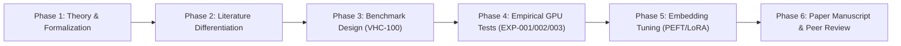

# Master Roadmap & Publication Backlog

> **Project:** Lingual Composite Learning  
> **Objective:** Publication of peer-reviewed scientific research paper and open-access benchmark (Author: Sebastian Oertel).  
> **Status:** Phase 1–4, 6 Completed; Pre-print live on GitHub.  

---

## 🗺️ The 6 Research Phases

---

## 📋 Phase-Specific Backlog

### Phase 1: Thesis, Ontology & Concept Foundation (Completed)
- [x] Core research hypothesis formulated (*The Latent Semantic Bottleneck Hypothesis* in [`HYPOTHESES.md`](file:///c:/workspace/Experimental/LingualCompositLearning/dev/HYPOTHESES.md)).
- [x] Formalization of concepts as tuples $C = \langle \mathcal{T}_C, \mathcal{I}_C, \pi_C, \mathcal{S}_C \rangle$.
- [x] Definition of sub-hypotheses H1 (Inference), H2 (Robustness), H3 (Compression), H4 (Compositionality).
- [x] Grounding in cognitive linguistics & control theory ([`concepts/SEMANTIC_DIMENSIONS.md`](file:///c:/workspace/Experimental/LingualCompositLearning/dev/concepts/SEMANTIC_DIMENSIONS.md)).
- [x] Morphological architecture & tokenizer parity for neologisms ([`concepts/MORPHOLOGY_AND_SYNTAX.md`](file:///c:/workspace/Experimental/LingualCompositLearning/dev/concepts/MORPHOLOGY_AND_SYNTAX.md)).
- [x] Canonical starter catalog (Vocabulary v1.0 in [`concepts/VOCABULARY_V1.md`](file:///c:/workspace/Experimental/LingualCompositLearning/dev/concepts/VOCABULARY_V1.md)).

### Phase 2: Literature Differentiation & State-of-the-Art (Completed)
- [x] Literature survey on Hewitt (2025/2026), Lupyan (2007), and Yang (2024).
- [x] Differentiation matrix established against *HRL (Options)*, *CBMs*, and *Constitutional AI* in [`literature/differentiation_matrix.md`](file:///c:/workspace/Experimental/LingualCompositLearning/dev/literature/differentiation_matrix.md).
- [x] Deep Literature Audit (2024–2026) regarding unfaithful CoT and embodied robotics benchmarks ([`literature/DEEP_LITERATURE_AUDIT_2026.md`](file:///c:/workspace/Experimental/LingualCompositLearning/dev/literature/DEEP_LITERATURE_AUDIT_2026.md)).

### Phase 3: Benchmark & Evaluation Suite (Completed)
- [x] VHC-100 Benchmark Suite with 100 adversarial scenarios across 4 domains ([`data/benchmarks/benchmark_v2.json`](file:///c:/workspace/Experimental/LingualCompositLearning/dev/data/benchmarks/benchmark_v2.json)).
- [x] Quantitative evaluator with bilingual stem matching and negation safeguards ([`src/lingual_research/evaluator.py`](file:///c:/workspace/Experimental/LingualCompositLearning/dev/src/lingual_research/evaluator.py)).
- [x] Independent LLM-as-a-Judge validation pipeline ([`src/lingual_research/audit_judge.py`](file:///c:/workspace/Experimental/LingualCompositLearning/dev/src/lingual_research/audit_judge.py)).

### Phase 4: Empirical GPU Benchmark Execution (RTX 5090) (Completed)
- [x] Local setup and execution of `Qwen/Qwen2.5-14B-Instruct` (27.65 GB VRAM on NVIDIA RTX 5090).
- [x] Execution of EXP-001 Pilot (10 scenarios, 30 inference runs).
- [x] Execution of EXP-002 Flagship Benchmark (100 scenarios, 300 runs); discovery of the *Semantic Dimensionality Trap* ([`findings/FINDINGS-EXP-002.md`](file:///c:/workspace/Experimental/LingualCompositLearning/dev/findings/FINDINGS-EXP-002.md)).
- [x] Execution of EXP-003 Hierarchical Composite Routing (100 scenarios); composite routing outperforms Verbose CoT in Domestic (60.8%) and Emergency (51.7%) domains at 12–16% lower latency ([`findings/FINDINGS-EXP-003.md`](file:///c:/workspace/Experimental/LingualCompositLearning/dev/findings/FINDINGS-EXP-003.md)).

### Phase 5: Soft-Token / Embedding Tuning (PEFT / LoRA) (Future Work)
- [ ] Bind concept tokens (`<|c_fufu|>`, `<|c_weli|>`, `<|c_zubu|>`) as trainable embedding vectors in open-weights LLMs via PEFT / LoRA.
- [ ] Evaluate direct conditioning without in-context prompts.
- [ ] Ablation: Neologism token vs natural language token.

### Phase 6: Manuscript, LaTeX & Open-Source Release (Completed)
- [x] Scientific research manuscript: [`papers/neurips_2026/PAPER_MANUSCRIPT.md`](file:///c:/workspace/Experimental/LingualCompositLearning/dev/papers/neurips_2026/PAPER_MANUSCRIPT.md).
- [x] Publication-ready LaTeX compilation: [`papers/neurips_2026/main.tex`](file:///c:/workspace/Experimental/LingualCompositLearning/dev/papers/neurips_2026/main.tex).
- [x] BibTeX references: [`papers/neurips_2026/references.bib`](file:///c:/workspace/Experimental/LingualCompositLearning/dev/papers/neurips_2026/references.bib).
- [x] Rigorous adversarial peer reviews (scores 8.2/10 and 8.5/10).
- [x] GitHub Repository Live at `https://github.com/CodiBasti/LingualCompositeLearning.git`.
- [ ] Full English internationalization across all documentation and scenarios.
