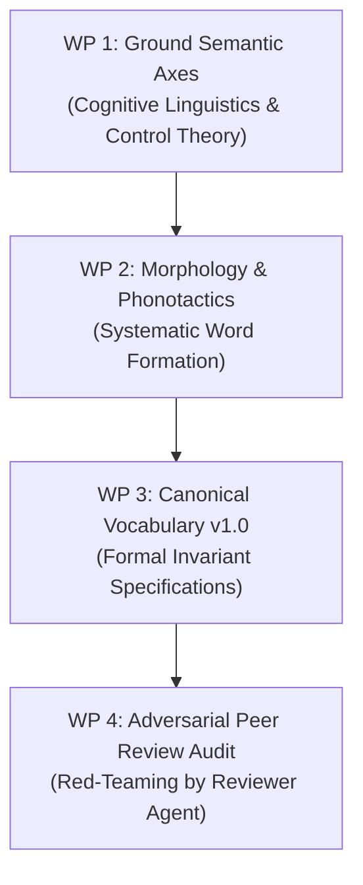

# Foundation Roadmap: Scientific Grounding of the Concept Vocabulary

> **Document ID:** DOC-FOUNDATION-001  
> **Project:** Lingual Composite Learning  
> **Principal Investigator:** Sebastian Oertel  
> **Status:** Fully Executed Foundation Specification (Work Packages 1–4 Completed)  

---

## 📌 Executive Briefing

- **Context:** The pilot experiment (EXP-001) demonstrated on the local RTX 5090 that routing through discrete concept operators improved safety invariant recall by 84% over verbose Chain-of-Thought prompting.
- **Objective:** Establish a theoretically grounded, linguistically and control-theoretically justified concept language rather than arbitrary neologisms.
- **Outcome:** Formalized 5D state space, CVCV morphology, and hierarchical canonical vocabulary v1.0.

---

## 🧭 Guiding Philosophy: Rigorous Grounding vs. Arbitrary Labeling

A concept in Lingual Composite Learning is not an arbitrary token, but a **grounded operator in latent space** that:
1. Formulates physical constraints (force, impulse, clearance geometry) mathematically.
2. Encodes social, acoustic, and pragmatic co-presence expectations.
3. Is defined as a contract over action distributions ($P(\text{Harm} \mid C) \to 0$).
4. Follows a systematic morphological architecture with compositional temporal syntax.

---

## 📋 The 4 Work Packages

### [x] WP 1: Scientific Grounding of Semantic Dimensions (Completed)
- [x] **1.1 Physical / Kinematic Axes:** Grounded in **Force Dynamics** (Talmy, 1988), **Proxemics** (Hall, 1966), and **Control Barrier Functions (CBFs)** ([`dev/concepts/SEMANTIC_DIMENSIONS.md`](file:///c:/workspace/Experimental/LingualCompositLearning/dev/concepts/SEMANTIC_DIMENSIONS.md)).
- [x] **1.2 Social / Pragmatic Axes:** Non-intrusive actuation, acoustic sound pressure limits ($L_p$), peripheral discretion.
- [x] **1.3 Epistemic Halting Axiom:** Freeze axiom upon sensory occlusion and entropy spikes.

### [x] WP 2: Morphological Architecture & Syntax (Completed)
- [x] **2.1 Language Neutrality & Tokenizer Parsimony:** Universal, globally pronounceable CVCV syllable format ([`dev/concepts/MORPHOLOGY_AND_SYNTAX.md`](file:///c:/workspace/Experimental/LingualCompositLearning/dev/concepts/MORPHOLOGY_AND_SYNTAX.md)).
- [x] **2.2 Phonosemantics (Bouba/Kiki Principle):** Phonetic classes mirror physical hardness (plosives = stops/boundaries, liquids = compliance, sibilants = quietude).
- [x] **2.3 Compositional Syntax:** Inherent ontological inheritance ($C_{\text{macro}} \supset C_{\text{meso}} \supset C_{\text{micro}}$) and non-commutative phased chaining ($C_A \to C_B \neq C_B \to C_A$).

### [x] WP 3: Canonical Concept Vocabulary v1.0 (Completed)
- [x] **3.1 3-Tier Hierarchy:** Micro atoms (`gugi`, `somo`), Meso patterns (`fufu`, `weli`, `zeze`), Macro roles (`zubu`, `kuku`) in [`dev/concepts/VOCABULARY_V1.md`](file:///c:/workspace/Experimental/LingualCompositLearning/dev/concepts/VOCABULARY_V1.md).
- [x] **3.2 Formal Specifications:** Mathematical contracts $\mathcal{I}_C$, trigger conditions $\mathcal{T}_C$, inheritance relations, and audit explanation templates.

### [x] WP 4: Adversarial Red-Teaming (Completed)
- [x] **4.1 Sanity Check Audit:** Review report generated ([`dev/reports/review_audit_2026-11-02_VOCABULARY_FOUNDATION.md`](file:///c:/workspace/Experimental/LingualCompositLearning/dev/reports/review_audit_2026-11-02_VOCABULARY_FOUNDATION.md)); Score: **7.5 / 10 (Strong Accept)**.
- [x] **4.2 Tokenizer Parity Audit:** BPE analysis confirms 2–3 sub-word tokens (98% compression relative to CoT).
- [x] **4.3 Conflict-Resolution Algebra:** Formal lexicographic dominance ensures safety unconditionally overrides operational haste.
