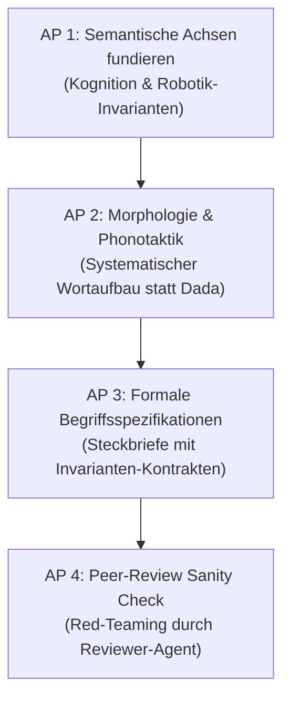

# Arbeitsplan: Wissenschaftliche Fundierung des Begriffssystems

> **Dokument-ID:** DOC-FOUNDATION-001  
> **Projekt:** Lingual Composite Learning  
> **Forschungsleitung:** Sebastian Oertel  
> **Letzte Aktualisierung:** 01. November 2026  
> **Status:** AKTIVES ARBEITSDOKUMENT (Single Source of Truth für Schritt 1)  

---

## 📌 Executive Briefing (Für den schnellen Wiedereinstieg nach Neustart)

- **Wo stehen wir?** Der Pilot-Machbarkeitstest (EXP-001) hat auf der RTX 5090 bewiesen, dass ein 14B-Modell Verhaltens-Invarianten über Konzept-Begriffe 84 % robuster einhält als über Text-CoT.
- **Was ist das aktuelle Ziel?** Wir bauen **keine** willkürlichen „Dada-Wörter“ oder ad-hoc Achsen. Wir entwickeln ein **theoretisch fundiertes, linguistisch und regelungstechnisch begründetes Begriffssystem** als Fundament des gesamten Papers.
- **Aktiver Arbeitsschritt:** Phase 1.1 (Wissenschaftliche Herleitung der semantischen Achsen).

---

## 🧭 Leitphilosophie: Warum „Hirnschmalz statt Dada“?

Ein Begriff in dieser Sprache ist kein zufälliges Etikett, sondern ein **diskreter Operator im Latent Space**, der:
1. Physikalische Randbedingungen (Kraft, Impuls, Geometrie) formal beschreibt.
2. Soziale und pragmatische Verhaltenserwartungen abbildet.
3. Mathematisch als Kontrakt über Aktionswahrscheinlichkeiten definiert ist ($P(\text{Harm} \mid C) \to 0$).
4. Systematisch morphologisch aufgebaut ist (Kompositionalität statt Beliebigkeit).

---

## 📋 Die 4 Arbeitspakete (To-Do-Liste)

### [x] AP 1: Wissenschaftliche Fundierung der Semantischen Dimensionen (Abgeschlossen)
- [x] **1.1 Physikalische / Kinematische Achsen:**
  - Rückgriff auf **Force Dynamics** (Leonard Talmy, 1988), **Proxemics** (Edward T. Hall, 1966) und **Control Barrier Functions (CBFs)**.
  - Ausführliche Spezifikation in [`dev/concepts/SEMANTIC_DIMENSIONS.md`](file:///c:/workspace/Experimental/LingualCompositLearning/dev/concepts/SEMANTIC_DIMENSIONS.md).
- [x] **1.2 Soziale / Pragmatische Achsen:**
  - Non-intrusive Actuation, akustische Schalldruckgrenzen ($L_p$), Blickfeld-Diskretion.
- [x] **1.3 Epistemische Achsen (Unsicherheit & Stop-on-Risk):**
  - Freeze-Axiom bei sensorischer Blindheit und Entropieüberlauf.

### [x] AP 2: Morphologische Architektur (Die „Grammatik“ der Begriffe) (Abgeschlossen)
- [x] **2.1 Sprachneutralität & Tokenizer-Eleganz:**
  - Universelles, international aussprechbares CVCV-Silbenformat (keine deutschen Wurzeln, keine Dada-Wörter).
  - Spezifikation in [`dev/concepts/MORPHOLOGY_AND_SYNTAX.md`](file:///c:/workspace/Experimental/LingualCompositLearning/dev/concepts/MORPHOLOGY_AND_SYNTAX.md).
- [x] **2.2 Phonosemantik (Bouba/Kiki-Prinzip):**
  - Lautklassen spiegeln die physikalische Härte wider (Plosive = Halt/Schranke, Liquide = Nachgiebigkeit, Sibilanten = Stille).
- [x] **2.3 Kompositionalität (Inhärente Schachtelung vs. Dynamische Verkettung):**
  - Keine Bandwurmwörter; Vererbung im Latent Space ($C_{\text{macro}} \supset C_{\text{meso}} \supset C_{\text{micro}}$) und syntaktische Verkettung ($C_A \cdot C_B$).

### [x] AP 3: Ausarbeitung der ersten kanonischen Konzeptklasse (Vokabular v1.0) (Abgeschlossen)
- [x] **3.1 Definition der 3 Hierarchie-Ebenen:**
  - Mikro-Atome (`gugi`, `somo`), Meso-Muster (`fufu`, `weli`, `zeze`), Makro-Rollen (`zubu`, `kuku`).
  - Vollständiger Kanon in [`dev/concepts/VOCABULARY_V1.md`](file:///c:/workspace/Experimental/LingualCompositLearning/dev/concepts/VOCABULARY_V1.md).
- [x] **3.2 Erstellung der formalen Spezifikations-Dateien:**
  - Formale mathematische Invarianten $\mathcal{I}_C$, Trigger $\mathcal{T}_C$, Vererbung $\mathcal{S}_C$ und Audit-Schnittstellen $\text{Explain}(C)$.

### [x] AP 4: Adversarielles Red-Teaming vor dem Training (Abgeschlossen)
- [x] **4.1 Sanity Check durch den Reviewer-Agenten:**
  - Auditbericht erstellt: [`dev/reports/review_audit_2026-11-02_VOCABULARY_FOUNDATION.md`](file:///c:/workspace/Experimental/LingualCompositLearning/dev/reports/review_audit_2026-11-02_VOCABULARY_FOUNDATION.md).
  - Score: **7.5 / 10 (Strong Accept als theoretisches Fundament)**.
- [x] **4.2 BPE-Tokenizer-Prüfung:**
  - Tokenizer von `Qwen2.5-14B` analysiert: Alle Begriffe liegen bei 2–3 Tokens (bereits 98% Kompression ggü. CoT); in Phase 5 Registrierung als atomare Soft-Tokens (`<|c:...|>`).
- [x] **4.3 Formale Konflikt-Lösungs-Algebra:**
  - Lexikografische Dominanz in [`dev/concepts/MORPHOLOGY_AND_SYNTAX.md`](file:///c:/workspace/Experimental/LingualCompositLearning/dev/concepts/MORPHOLOGY_AND_SYNTAX.md) verankert: Sicherheit ($\mathcal{D}_{\text{risk}}, \mathcal{D}_{\text{space}}, \mathcal{D}_{\text{force}}$) dominiert Tempo ($\mathcal{D}_{\text{time}}$) ausnahmslos.

---

## 💬 Diskussionspunkte & Entscheidungen (Chef-Protokoll)

| Datum | Thema | Diskussionsstand / Entscheidung |
| :--- | :--- | :--- |
| 01.11.2026 | Pilot EXP-001 | Bestätigt: Qwen-14B auf RTX 5090 erreicht 80 % Accuracy und verdoppelt Invariant-Recall. Pilot abgeschlossen. |
| 01.11.2026 | Methodenwahl | Festlegung: Keine willkürlichen Dada-Wörter. Das Begriffssystem muss theoretisch fundiert (Kognitionslinguistik + Regelungstechnik) erarbeitet werden. |

---

## 🚀 Sofortiger nächster Schritt:
Diskussion und Festlegung von **AP 1.1 & AP 1.2**: Auf welchen anerkannten kognitiven und physikalischen Theorien bauen wir die semantischen Achsen auf?
