# Research Map & Project Phases

This research map delineates the developmental phases, dependencies, and scientific milestones of **Lingual Composite Learning**.

```mermaid
flowchart TD
    subgraph Phase0["Phase 0: Theoretical Foundations & Prior Art"]
        P0_Lit["Literature Survey & Differentiation<br/>(Hewitt, Lupyan, Yang)"]
        P0_Tax["5D Semantic Coordinates & Taxonomy<br/>(Forces, Space, Social, Risk, Time)"]
    end

    subgraph Phase1["Phase 1: Concept & Benchmark Modeling"]
        P1_Fufu["Formal Specification of Operators<br/>(fufu, weli, zubu, kuku, gugi)"]
        P1_Scen["VHC-100 Benchmark Design<br/>(100 Scenarios Across 4 Domains)"]
    end

    subgraph Phase2["Phase 2: In-Context Baseline Benchmarks"]
        P2_LLM["EXP-001 & EXP-002 on RTX 5090<br/>(Naive vs. Verbose CoT vs. Concept Routing)"]
        P2_Comp["LLM-as-a-Judge Audit Pipeline<br/>(Unmasking Lip-Service CoT)"]
    end

    subgraph Phase3["Phase 3: Hierarchical Composite Routing"]
        P3_Embed["EXP-003 Phased Composite Routing<br/>(Phased Space-to-Force Synthesis)"]
        P3_Transfer["Zero-Shot Cross-Domain Generalization<br/>(Domestic, Care, Lab, Emergency)"]
    end

    subgraph Phase4["Phase 4: Scientific Manuscript & Preprint"]
        P4_Study["Full Conference Manuscript & LaTeX<br/>(PAPER_MANUSCRIPT.md & main.tex)"]
        P4_Form["Open-Access GitHub Release & Dashboard<br/>(demo_dashboard.html & VHC-100 JSON)"]
    end

    subgraph Phase5["Phase 5: Embodiment & Continuous Embeddings"]
        P5_Logic["Soft-Token Embedding Tuning<br/>(PEFT / LoRA Token Representations)"]
        P5_Sim["Physics Simulation & Robot Verification<br/>(Isaac Lab / PyBullet Mobile Manipulation)"]
    end

    Phase0 --> Phase1
    Phase1 --> Phase2
    Phase2 --> Phase3
    Phase3 --> Phase4
    Phase4 --> Phase5
```

---

## 📅 Phase Overview & Milestones

### Phase 0: Foundations, Taxonomy & Literature Differentiation (Completed)
- **Objective:** Precise delimitation of our research contribution against prior art.
- **Milestones:** Theoretical derivation of the 5-dimensional coordinate manifold ([`concepts/SEMANTIC_DIMENSIONS.md`](file:///c:/workspace/Experimental/LingualCompositLearning/dev/concepts/SEMANTIC_DIMENSIONS.md)) and differentiation matrix ([`literature/differentiation_matrix.md`](file:///c:/workspace/Experimental/LingualCompositLearning/dev/literature/differentiation_matrix.md)).

### Phase 1: Concept Modeling & Benchmark Design (Completed)
- **Objective:** Formalizing concept operators into verifiable contracts and building the VHC-100 benchmark suite.
- **Milestones:** Canonical vocabulary v1.0 ([`concepts/VOCABULARY_V1.md`](file:///c:/workspace/Experimental/LingualCompositLearning/dev/concepts/VOCABULARY_V1.md)) and 100 standardized peer-reviewed adversarial scenarios ([`data/benchmarks/benchmark_v2.json`](file:///c:/workspace/Experimental/LingualCompositLearning/dev/data/benchmarks/benchmark_v2.json)).

### Phase 2: Empirical In-Context Baselines on Local RTX 5090 (Completed)
- **Objective:** Evaluate foundation models (Qwen2.5-14B) on Naive, Verbose CoT, and Concept Routing conditions.
- **Milestones:** Flagship benchmark EXP-002 completed across 300 inference runs; identified the *Semantic Dimensionality Trap* (44% atomic accuracy) and unmasked CoT lip-service via LLM-as-a-Judge audits.

### Phase 3: Hierarchical Composite Routing (Completed)
- **Objective:** Resolve the dimensionality trap via phased multi-label composition (`fufu-weli`).
- **Milestones:** EXP-003 completed; classification accuracy surged to 68.0% (80% in lab); outperformed Verbose CoT in Domestic (60.8%) and Emergency (51.7%) at 12–16% lower latency.

### Phase 4: Research Manuscript & Open-Access Repository (Completed)
- **Objective:** Publication-grade manuscript, LaTeX layout, BibTeX bibliography, and GitHub repository.
- **Milestones:** Camera-ready manuscript drafted, adversarial Reviewer 2 audits passed (8.2/10 and 8.5/10), public repository live on GitHub.

### Phase 5: Embodiment, Robotics & Continuous Soft Tokens (Future Work)
- **Objective:** Continuous representation learning and closed-loop robotic execution.
- **Milestones:** Train discrete soft tokens (`<|c_fufu|>`) via LoRA and interface with physical simulation environments (Isaac Lab / PyBullet).
