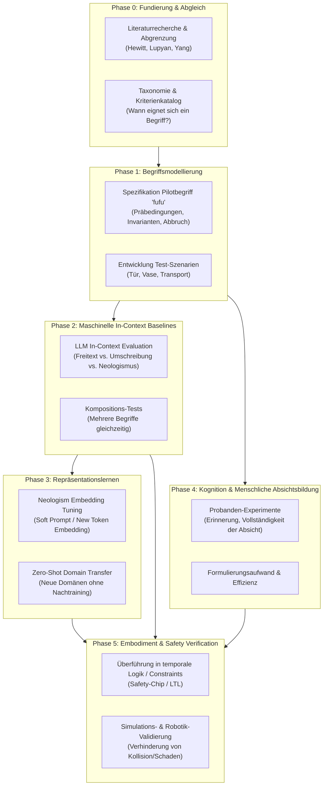

# Forschungslandkarte (Research Map)

Diese Forschungslandkarte beschreibt die Phasen, Abhängigkeiten und Meilensteine des Projekts **Lingual Composite Learning**.

---

## 📅 Phasenübersicht & Meilensteine

### Phase 0: Fundierung, Taxonomie & Abgrenzung (Aktuell)
- **Ziel:** Saubere Trennung von bereits publizierten Ansätzen und eigener Forschungslücke.
- **Kernfragen:**
  - Welche Aspekte sind durch *Hewitt et al. (2025/2026)* und *Yang et al. (2024)* bereits abgedeckt?
  - Was ist der spezifische Mehrwert der Kombination aus **menschlicher Absichtsbildung + maschinellem Transfer + Sicherheitsverifikation**?
- **Ergebnis:** Strukturierte Literaturberichte in [`literature/`](file:///c:/workspace/Experimental/LingualCompositLearning/dev/literature).

### Phase 1: Begriffsmodellierung & Szenariendesign
- **Ziel:** Formalisierung von Begriffen in beobachtbare Bedingungen und Handlungsregeln.
- **Arbeitspakete:**
  - Pilot-Spezifikation für `fufu` ([`concepts/fufu.md`](file:///c:/workspace/Experimental/LingualCompositLearning/dev/concepts/fufu.md)).
  - Erstellung von Benchmark-Szenarien in [`data/scenarios/`](file:///c:/workspace/Experimental/LingualCompositLearning/dev/data/scenarios) (z. B. Türöffnung mit Person dahinter, Transport von zerbrechlichen Objekten).
  - Definition von Negativ- und Grenzfällen (Wann muss zwingend gestoppt werden?).

### Phase 2: Maschinelle In-Context-Baselines
- **Ziel:** Messung, wie heutige SOTA-LLMs auf definierte Neologismen reagieren, wenn die Definition im Prompt / System-Prompt bereitgestellt wird.
- **Vergleichsgruppen:**
  1. Reine Basis-Anweisung („Öffne die Tür.“)
  2. Ausführliche Umschreibung („Öffne die Tür vorsichtig, achte auf Personen...“)
  3. Begriffliche Anweisung mit hinterlegter Definition („Öffne die Tür, fufu.“ + System-Definition von fufu)
- **Metriken:** Vollständigkeit der Handlungsplanung, Reaktionszeit bei Störungen, Erkennung von Abbruchbedingungen.

### Phase 3: Neologism Learning & Repräsentationslernen
- **Ziel:** Untersuchung von echtem Begriffslernen im Modell (ohne lange System-Prompts).
- **Ansatz:** Training neuer Token-Embeddings (wie Hewitt et al. 2026) oder PEFT/LoRA-Adapter.
- **Ergebnis:** Bewertung, ob trainierte Repräsentationen robuster generalisieren als In-Context-Prompts.

### Phase 4: Kognition & Menschliche Absichtsbildung
- **Ziel:** Empirische Überprüfung des psycholinguistischen Effekts (angelehnt an Lupyan et al. 2007).
- **Test:** Führt das Vorhandensein eines Begriffs dazu, dass Testpersonen in komplexen Situationsbeschreibungen signifikant seltener sicherheitsrelevante Einschränkungen vergessen?

### Phase 5: Embodiment, Robotics & Safety Verification
- **Ziel:** Physische/simulative Verifikation (in Habitat, Isaac Sim oder PyBullet).
- **Integration:** Übersetzung des Begriffs in formale Guardrails / Safety-Chips (Yang et al. 2024).
