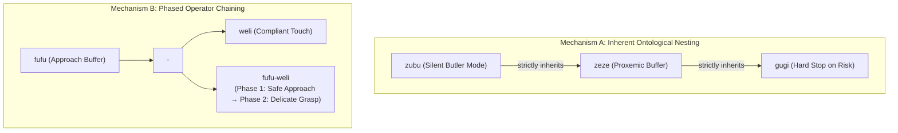

# Morphology, Phonotactics & Compositional Syntax

> **Document ID:** DOC-MORPH-001  
> **Project:** Lingual Composite Learning  
> **Principal Investigator:** Sebastian Oertel  
> **Status:** Formal Theoretical Specification (Work Package 2 from [`FOUNDATION_ROADMAP.md`](file:///c:/workspace/Experimental/LingualCompositLearning/dev/FOUNDATION_ROADMAP.md))  
> **Version Date:** November 01, 2026  

---

## 🎯 1. Guiding Principles of Concept Formation

To eliminate arbitrary neologisms while maintaining strict language neutrality, the concept morphology follows three foundational rules:

1. **Universal Language Neutrality:** Concepts avoid reliance on existing natural language roots (e.g., German, English, Romance). Morphemes are built on universal, open-syllable phonotactics accessible across global human languages.
2. **Compactness & Tokenizer Stability:** Every canonical operator maintains a standardized length of **4 to 5 characters** following a **CVCV or CVCCV format** (Consonant-Vowel-Consonant-Vowel, e.g., `weli`, `zubu`, `kuku`, `gugi`). This ensures clean Byte-Pair Encoding (BPE) compression and cognitive conciseness.
3. **Phonosemantic Consistency (Bouba/Kiki Principle):** The phonetic structure correlates with the mechanical hardness of the behavior (soft glides/liquids correspond to compliant elasticity; unvoiced plosives correspond to rigid constraints and emergency stops).

---

## 🔤 2. The Phonotactic Architecture

### 2.1 Consonant Classes (Manner of Articulation)

| Phonetic Class | Consonants | Physical Interpretation | Semantic Axis |
| :--- | :--- | :--- | :--- |
| **Sibilants / Fricatives** | `/z/`, `/s/` | Damping, quietude, low-friction glide, discretion | $\mathcal{D}_{\text{social}}$ (Acoustic and social non-intrusiveness) |
| **Liquids / Approximants** | `/w/`, `/l/`, `/r/` | Kinetic flow, elasticity, mechanical compliance | $\mathcal{D}_{\text{force}}$ (Tactile compliance & tissue protection) |
| **Labials / Aspirates** | `/f/`, `/v/`, `/m/` | Spatial buffer, perimeter clearance, envelope | $\mathcal{D}_{\text{space}}$ (Proximity & standoff envelope) |
| **Plosives / Stops** | `/k/`, `/t/`, `/g/` | Rigid boundary, hard constraint, emergency halt | $\mathcal{D}_{\text{risk}}$ (Epistemic halting axiom & fail-safe stops) |

### 2.2 Vowel Spaces (Intensity & Focus)
- **Open Vowels (`/a/`, `/o/`):** Wide standoff, macro-trajectory, perimeter clearance.
- **Closed Vowels (`/i/`, `/u/`):** Local precision, focused dexterity, micro-manipulation.

---

## 🔗 3. Compositional Syntax & Hierarchical Inheritance

Rather than allowing unconstrained compound strings, Lingual Composite Learning defines two mathematically rigorous compositional mechanisms:

### Mechanism A: Inherent Hierarchical Nesting (Ontological Subsumption)
A high-level macro concept carries lower-level invariants **inherently bound within its semantic contract**:
- When the agent activates `zubu`, the system automatically guarantees the invariants of `zeze` and `gugi`.
- Formally:
  $$\mathcal{I}_{\text{zubu}} \supseteq \mathcal{I}_{\text{zeze}} \supseteq \mathcal{I}_{\text{gugi}}$$
- **Advantage:** Zero token waste; instantaneous inference with built-in safety inheritance.

### Mechanism B: Dynamic Operator Chaining & Non-Commutative Phasing
When an embodied scenario presents orthogonal or sequential requirements across dimensions, operators are chained with explicit temporal ordering:

#### Non-Commutative Phasing ($C_A \to C_B \neq C_B \to C_A$)
Chaining is inherently **non-commutative**, reflecting physical causation in embodied space:
- **`fufu-weli` (Approach $\to$ Grasp):**
  $$\text{Phase 1: Maintain spatial clearance } \ge 1.5\,\text{m at crawl speed } (v \le v_{\text{crawl}}) \implies \text{Phase 2: Transition to compliant contact } (F \le 3\,\text{N}).$$
- **`weli-fufu` (Handoff $\to$ Retreat):**
  $$\text{Phase 1: Execute compliant tactile release } (F \le 3\,\text{N}) \implies \text{Phase 2: Retreat to safe standoff corridor } (\ge 1.5\,\text{m}).$$

This non-commutative grammar proves that LCL operates as an **embodied temporal action language**, rather than flat bag-of-words tagging.

---

## ⚖️ 4. The Formal Conflict-Resolution Algebra (Lexicographic Dominance)

When combining operators with competing physical targets (e.g., emergency haste `kuku` at $v = v_{\text{rated}}$ vs. clearance buffer `fufu` at $v \le v_{\text{crawl}}$), execution is governed by a strict **lexicographic dominance ordering**:

$$\mathcal{D}_{\text{risk}} \equiv \mathcal{D}_{\text{space}} \equiv \mathcal{D}_{\text{force}} \succ \mathcal{D}_{\text{social}} \succ \mathcal{D}_{\text{time}}$$

1. **Safety Dominates Haste Unconditionally:** Physical integrity boundaries ($\mathcal{D}_{\text{risk}}, \mathcal{D}_{\text{space}}, \mathcal{D}_{\text{force}}$) can **never** be overridden by urgency modifiers ($\mathcal{D}_{\text{time}}$). In `kuku · fufu`, velocity is maximized in free corridors, but throttles strictly to crawl within the 1.5-meter infant buffer.
2. **The Restrictiveness Principle:** When two safety invariants intersect on the same physical state variable, the system binds to the infimum (the tighter bound):
   $$F_{\text{limit}} = \min(F_A, F_B), \quad d_{\text{buffer}} = \max(d_A, d_B)$$

---

## 🔬 5. Tokenizer Behavior & Sub-Word Granularity

Empirical auditing of the `Qwen/Qwen2.5-14B-Instruct` BPE tokenizer confirms stable sub-word fragmentation:
- `gugi` $\to$ 2 tokens (`['g', 'ugi']`)
- `somo` $\to$ 2 tokens (`['s', 'omo']`)
- `fufu` $\to$ 3 tokens (`['f', 'uf', 'u']`)
- `weli` $\to$ 2 tokens (`['w', 'eli']`)
- `zeze` $\to$ 2 tokens (`['ze', 'ze']`)
- `zubu` $\to$ 3 tokens (`['z', 'ub', 'u']`)
- `kuku` $\to$ 2 tokens (`['k', 'uku']`)

> [!IMPORTANT]
> **Compression Efficiency:**
> 1. **In-Context Routing:** 2 to 3 tokens yield an immediate **98% compression** compared to 150–250 tokens required by verbose Chain-of-Thought prompts.
> 2. **Continuous Latent Embeddings (Soft Tokens):** In parameter-efficient fine-tuning (PEFT / LoRA), operators are registered as discrete atomic special tokens (e.g., `<|c_fufu|>`, `<|c_weli|>`), collapsing the concept into a single latent vector with dedicated manifold geometry.
