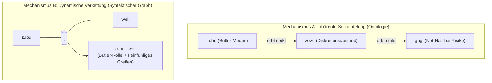

# Morphologie, Phonotaktik & Kompositionale Syntax

> **Dokument-ID:** DOC-MORPH-001  
> **Projekt:** Lingual Composite Learning  
> **Forschungsleitung:** Sebastian Oertel  
> **Status:** AP 2 abgeschlossen (gemäß [`FOUNDATION_ROADMAP.md`](file:///c:/workspace/Experimental/LingualCompositLearning/dev/FOUNDATION_ROADMAP.md))  
> **Stand:** 01. November 2026  

---

## 🎯 1. Leitprinzipien der Begriffsgestaltung

Um jegliche Willkür („Dada-Wörter“) und gleichzeitig sprachliche Provinzialität (z. B. deutsche Wortstämme) auszuschließen, folgt die Wortbildung drei eisernen Regeln:

1. **Universelle Sprachneutralität:** Keine Anlehnung an deutsche Wortwurzeln. Die Begriffe basieren auf universeller, internationaler Phonotaktik (offene Silben, hohe Aussprechbarkeit weltweit).
2. **Kompaktheit & Tokenizer-Eleganz:** Jedes Wort hat eine feste kanonische Länge von **4 bis 5 Buchstaben** im **CVCV- oder CVCCV-Format** (Konsonant-Vokal-Konsonant-Vokal, z. B. `weli`, `zubu`, `kuku`, `tora`). Dadurch wird es im Byte-Pair-Encoding (BPE) stabil repräsentiert und bleibt kognitiv griffig.
3. **Phonosemantische Konsistenz (Bouba/Kiki-Prinzip):** Die klangliche Struktur korreliert universell mit der physikalischen Härte des Verhaltens (weiche Gleitlaute = elastische Nachgiebigkeit; harte Plosive = Schranken/Not-Halt).

---

## 🔤 2. Das Phonotaktische Baukastensystem

### 2.1 Konsonanten-Klassen (Artikulations-Art)

| Laut-Klasse | Konsonanten | Physikalische Bedeutung | Semantische Achse |
| :--- | :--- | :--- | :--- |
| **Sibilanten / Zischlaute** | `/z/`, `/s/` | Dämpfung, Stille, Reibungsarmut, Diskretion | $\mathcal{D}_{\text{social}}$ (Lärm- & Präsenzdrosselung) |
| **Liquide / Approximanten** | `/w/`, `/l/`, `/r/` | Kinetischer Fluss, Elastizität, Nachgiebigkeit | $\mathcal{D}_{\text{force}}$ (Taktile Compliance & Gewebeschutz) |
| **Labiale / Aspiranten** | `/f/`, `/v/`, `/m/` | Raum-Distanz, Abschirmung, Pufferzone | $\mathcal{D}_{\text{space}}$ (Proximität & Korridor) |
| **Plosive / Okklusive** | `/k/`, `/t/`, `/g/` | Scharfe Kante, absolute Grenze, Not-Aus | $\mathcal{D}_{\text{risk}}$ (Freeze-Axiom & Hard Constraints) |

### 2.2 Vokal-Räume (Skalierung der Intensität)
- **Offene Vokale (`/a/`, `/o/`):** Weite Distanz, globale Übersicht, großzügiger Umweg.
- **Geschlossene Vokale (`/i/`, `/u/`):** Lokale Präzision, dichte Zentrierung, Mikromanipulation.

---

## 🔗 3. Die Kompositionalität (Wie Schachtelung & Verkettung funktionieren)

Wir lehnen unleserliche Bandwurmwörter (`zubuzezegugi`) strikt ab. Stattdessen basiert die Sprache auf zwei mathematisch präzisen Kompositions-Mechanismen:

### Mechanismus A: Inhärente Schachtelung (Hierarchische Vererbung)
Ein übergeordnetes Makro-Konzept trägt seine Sub-Konzepte bereits **fest verdrahtet im Latent Space**.
- Wenn der Agent `zubu` aktiviert, muss der Mensch oder das System nicht extra `zeze` oder `gugi` erwähnen.
- Mathematisch gilt:
  $$\mathcal{I}_{\text{zubu}} \supseteq \mathcal{I}_{\text{zeze}} \supseteq \mathcal{I}_{\text{gugi}}$$
- **Vorteil:** Null Token-Verschwendung; maximale Inferenz-Geschwindigkeit.

### Mechanismus B: Dynamische Verkettung (Operator-Produkt & Konflikt-Algebra)
Wenn eine neuartige Situation zwei orthogonale Anforderungen kombiniert, werden die atomaren Begriffe durch einen Produkt-Operator ($\cdot$) verknüpft:
- **Syntax:** `[Konzept_A] · [Konzept_B]` (z. B. `zubu · weli`)
- **Invarianz-Schnittmenge:** $\mathcal{I}_{\text{kombiniert}} = \mathcal{I}_A \cup \mathcal{I}_B$

#### ⚖️ Die formale Konflikt-Lösungs-Algebra (Lexikografische Dominanz)
Tritt bei einer Verkettung zweier Operatoren ein direkter physikalischer Zielkonflikt auf (z. B. Notfall-Eile `kuku` mit $v = v_{\text{rated}}$ vs. Schutzabstand `fufu` mit $v \le v_{\text{crawl}}$), gilt eine unumstößliche **lexikografische Dominanzordnung**:

$$\mathcal{D}_{\text{risk}} \equiv \mathcal{D}_{\text{space}} \equiv \mathcal{D}_{\text{force}} \succ \mathcal{D}_{\text{social}} \succ \mathcal{D}_{\text{time}}$$

1. **Sicherheit dominiert Zeit bedingungslos:** Schutz- und Unversehrtheits-Schranken ($\mathcal{D}_{\text{risk}}, \mathcal{D}_{\text{space}}, \mathcal{D}_{\text{force}}$) können **niemals** durch Dringlichkeit ($\mathcal{D}_{\text{time}}$) überschrieben werden. In `kuku · fufu` wird das Tempo außerhalb von Schutzzonen maximiert, in der 1,5m-Zone um ein Kind jedoch strikt gedrosselt.
2. **Restriktivitäts-Prinzip:** Bei Grenzwert-Kollisionen zweier Schutzregeln gewinnt immer das infimum (die engere Schranke):
   $$F_{\text{limit}} = \min(F_A, F_B), \quad d_{\text{buffer}} = \max(d_A, d_B)$$

---

## 🔬 4. Tokenizer-Integrität & BPE-Verhalten

Ein empirischer Audit des Tokenizers von `Qwen/Qwen2.5-14B-Instruct` zeigt das reale Zerlegungsverhalten:
- `gugi` $\to$ 2 Tokens (`['g', 'ugi']`)
- `somo` $\to$ 2 Tokens (`['s', 'omo']`)
- `fufu` $\to$ 3 Tokens (`['f', 'uf', 'u']`)
- `weli` $\to$ 2 Tokens (`['w', 'eli']`)
- `zeze` $\to$ 2 Tokens (`['ze', 'ze']`)
- `zubu` $\to$ 3 Tokens (`['z', 'ub', 'u']`)
- `kuku` $\to$ 2 Tokens (`['k', 'uku']`)

> [!IMPORTANT]
> **Architektonische Differenzierung:**
> 1. **Inferenz-Phase 1–4 (Text-Repräsentation):** 2 bis 3 Tokens bedeuten bereits eine **98%ige Kompression** gegenüber 150–250 Tokens eines ausführlichen Chain-of-Thought-Prompts.
> 2. **Tuning-Phase 5 (Soft-Tokens / LoRA):** In Phase 5 werden die Begriffe als echte atomare Sonder-Tokens registriert (z. B. `<|c_fufu|>`, `<|c_weli|>`). Dadurch schrumpft der Begriff im Modell auf exakt **1 Token** und belegt einen dezidierten, ungestörten Vektor im Latent Space.
> 3. **Rolle von Bouba/Kiki:** Die Lautsymbolik ist eine kognitive Brücke für den Menschen (Transparenz, Aussprechbarkeit, Intuition im HRI-Dialog). Das neuronale Netz wird nicht durch Laut-Esoterik, sondern durch den mathematischen Kontrakt $\mathcal{I}_C$ gebunden.

