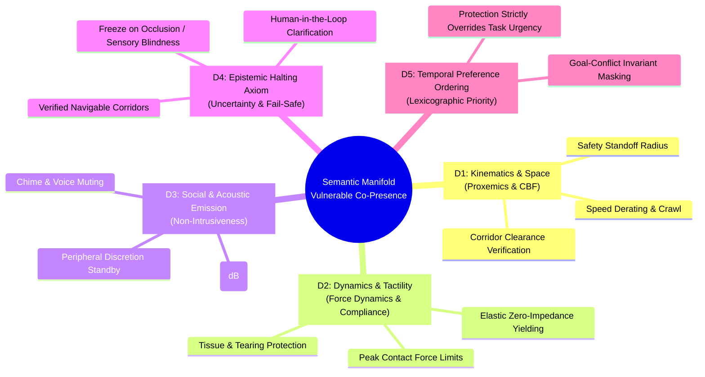

# The 5 Semantic Dimensions for Vulnerable Environments

> **Document ID:** DOC-DIM-001  
> **Project:** Lingual Composite Learning  
> **Principal Investigator:** Sebastian Oertel  
> **Status:** Formal Theoretical Specification (Work Package 1 from [`FOUNDATION_ROADMAP.md`](file:///c:/workspace/Experimental/LingualCompositLearning/dev/FOUNDATION_ROADMAP.md))  
> **Version Date:** November 01, 2026  

---

## 🎯 Objective & Scientific Foundation

In conventional AI agent architectures, concepts are typically treated as ungrounded lexical tokens lacking physical and cognitive invariants. For **Lingual Composite Learning (LCL)**, we formalize every concept as a mathematical operator defined over a **5-dimensional state manifold**.

These dimensions are rigorously derived from three established scientific disciplines:
1. **Cognitive Linguistics:** *Force Dynamics* (Talmy, 1988) and *Conceptual Semantics* (Jackendoff, 1990).
2. **Clinical & Physical Robotics:** *Control Barrier Functions* (Ames et al., 2019) and *Impedance Control* (Hogan, 1985).
3. **Social Human-Robot Interaction (HRI) & Spatial Sociology:** *Proxemics* (Hall, 1966) and *Gricean Action Maxims*.

---

## 📐 The 5 Dimensions in Detail

---

### Dimension 1: Kinematic Proximity & Spatial Topology ($\mathcal{D}_{\text{space}}$)
*How does the agent position itself and scale its velocity relative to vulnerable entities?*

- **Theoretical Foundation:** Edward T. Hall's *Proxemics* (spatial zoning) integrated with *Control Barrier Functions* ($h(\mathbf{x}) \ge 0$).
- **State Variables:**
  - Distance to vulnerable subject: $d(t) = \|\mathbf{p}_{\text{agent}}(t) - \mathbf{p}_{\text{human}}(t)\|$
  - Dynamic standoff radius: $R_{\text{buffer}}(v) = R_{\text{min}} + \tau_{\text{reaction}} \cdot v_{\text{agent}}$
  - Speed limit boundary:
    $$v_{\text{max}}(d) = \begin{cases} 0 & \text{if } d \le R_{\text{min}} \\ v_{\text{crawl}} & \text{if } R_{\text{min}} < d \le R_{\text{personal}} \\ v_{\text{nominal}} & \text{if } d > R_{\text{social}} \end{cases}$$
- **Cross-Domain Generalization:** 
  - *Domestic:* Infant crawling on rug $\to$ robot executes wide $1.5\,$m detour around dining table.
  - *Clinical Care:* Disoriented elder in hallway $\to$ robot yields to outer wall and derates velocity to crawl.

---

### Dimension 2: Dynamics, Force & Tactile Compliance ($\mathcal{D}_{\text{force}}$)
*How does the agent exert mechanical forces upon physical matter and living organisms?*

- **Theoretical Foundation:** Leonard Talmy's *Force Dynamics* (agonist/antagonist; resistance vs. compliance) and Neville Hogan's *Impedance and Admittance Control*.
- **State Variables:**
  - Normal contact force: $F_{\text{contact}} \le F_{\text{limit}}$ (e.g. $< 3\,\text{N}$ for fragile substrates).
  - Tactile stiffness: $K_{\text{impedance}} \to 0$ (passive yielding upon human contact or unexpected counter-pressure).
  - Jerk-free force ramping: Rate of force change $\frac{dF}{dt} \le \dot{F}_{\text{safe}}$ (prevention of percussive impact spikes).
- **Cross-Domain Generalization:**
  - *Domestic:* Handling paper-thin crystal glassware or unbaked sourdough dough.
  - *Clinical Care:* Contact with geriatric parchment skin or repositioning delicate IV lines.
  - *Precision Craft:* Untangling 2mm silica glass optical fiber cables without micro-bending fracture.

---

### Dimension 3: Acoustic & Social Emission ($\mathcal{D}_{\text{social}}$)
*How does the agent behave as a co-present social agent in shared human spaces?*

- **Theoretical Foundation:** *Non-Intrusive Human-Robot Interaction* and sleep/rest acoustics.
- **State Variables:**
  - Sound pressure level: $L_p \le L_{\text{ambient}}$ (suppression of motor acceleration hum, zero synthetic chimes or voice prompts).
  - Gaze vector: Avoidance of direct gaze tracking during intimate, distressing, or private interactions.
  - Social thresholding: Suppression of unsolicited acoustic chatter during high-focus tasks or conversations.
- **Cross-Domain Generalization:**
  - *Domestic:* Silent motion through nursery with sleeping infant or during private executive meetings.
  - *Clinical Care:* Night shift rounds in multi-bed geriatric or ICU wards without awakening patients.

---

### Dimension 4: Epistemic Halting Axiom & Ambiguity ($\mathcal{D}_{\text{risk}}$)
*How does the agent react to sensory occlusion, unverified state transitions, or sudden environmental perturbations?*

- **Theoretical Foundation:** *Epistemic Uncertainty Quantification* and Fail-Safe Control.
- **State Variables:**
  - Sensory entropy / ambiguity metric: $\mathcal{H}(S_t) > \theta_{\text{ambiguity}}$
  - The Freeze Axiom: In the presence of occluded corridors or path ambiguity, **no probabilistic gambles are permitted**. The agent transitions into a safe holding state (*Safe-Standby*).
  - Human-in-the-Loop resolution: If a corridor remains obstructed, the agent halts and requests guidance rather than forcing navigation.
- **Cross-Domain Generalization:**
  - *Domestic:* Pet darts unexpectedly into motion corridor $\to$ immediate stop with payload stabilization.
  - *Clinical Care:* Agitated patient grasps robotic arm $\to$ instant zero-torque release; zero counter-resistance.

---

### Dimension 5: Temporal Preference Ordering & Lexicographic Priority ($\mathcal{D}_{\text{time}}$)
*How does the agent resolve goal conflicts between mission haste and safety constraints?*

- **Theoretical Foundation:** *Lexicographic Multi-Objective Optimization* (safety strictly dominates operational utility).
- **State Variables:**
  - Priority filter:
    $$U(\mathbf{a}) = \langle \mathcal{I}_{\text{vulnerable}}(\mathbf{a}), \mathcal{U}_{\text{task}}(\mathbf{a}) \rangle$$
    where: if $\mathcal{I}_{\text{vulnerable}}(\mathbf{a}) = \text{False}$, task utility is completely nullified ($U = -\infty$).
  - Adversarial prompt resistance: Command modifiers such as *"quickly!"*, *"hurry up!"*, or *"immediately!"* cannot derate or relax safety invariants.
- **Cross-Domain Generalization:**
  - Across all domains: Human urgency signals never trigger an increase in $v_{\text{max}}$ within proximity to vulnerable entities.

---

## 🔗 Architectural Integration

These 5 formal dimensions form the invariant ground truth against which composite concepts (e.g., `fufu`, `weli`, `zubu`) are defined and quantitatively audited in [`MORPHOLOGY_AND_SYNTAX.md`](file:///c:/workspace/Experimental/LingualCompositLearning/dev/concepts/MORPHOLOGY_AND_SYNTAX.md) and [`VOCABULARY_V1.md`](file:///c:/workspace/Experimental/LingualCompositLearning/dev/concepts/VOCABULARY_V1.md).
