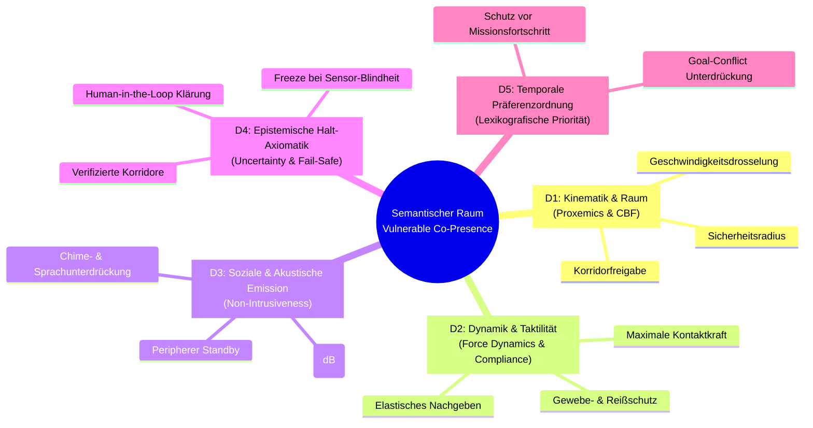

# Die 5 Semantischen Dimensionen für Vulnerable Umgebungen

> **Dokument-ID:** DOC-DIM-001  
> **Projekt:** Lingual Composite Learning  
> **Forschungsleitung:** Sebastian Oertel  
> **Status:** Arbeitsfassung (AP 1 aus [`FOUNDATION_ROADMAP.md`](file:///c:/workspace/Experimental/LingualCompositLearning/dev/FOUNDATION_ROADMAP.md))  
> **Stand:** 01. November 2026  

---

## 🎯 Zielsetzung & Wissenschaftliche Fundierung

In herkömmlichen KI-Agenten werden Begriffe oft als rein lexikalische Token ohne physikalische oder kognitive Verankerung behandelt. Für **Lingual Composite Learning** definieren wir jeden Begriff als Operator über einem **5-dimensionalen Zustandsraum**. 

Diese Dimensionen sind nicht willkürlich gewählt, sondern leiten sich aus drei etablierten wissenschaftlichen Disziplinen ab:
1. **Kognitive Sprachwissenschaft:** *Force Dynamics* (Talmy, 1988) und *Conceptual Semantics* (Jackendoff, 1990).
2. **Klinische & Physische Robotik:** *Control Barrier Functions* (Ames et al., 2019) und *Impedance Control* (Hogan, 1985).
3. **Soziale HRI & Raumsoziologie:** *Proxemics* (Hall, 1966) und *Gricean Action Maxims*.

---

## 📐 Die 5 Dimensionen im Detail

---

### Dimension 1: Kinematische Proximität & Raum-Topologie ($\mathcal{D}_{\text{space}}$)
*Wie verhält sich der Agent geometrisch und geschwindigkeitsbezogen relativ zu Schutzobjekten?*

- **Theoretische Basis:** Edward T. Halls *Proxemics* (Zonierung des Raums) kombiniert mit *Control Barrier Functions* ($h(\mathbf{x}) \ge 0$).
- **Zustandsvariablen:**
  - Abstand zum vulnerablen Subjekt: $d(t) = \|\mathbf{p}_{\text{agent}}(t) - \mathbf{p}_{\text{human}}(t)\|$
  - Dynamischer Puffer-Radius: $R_{\text{buffer}}(v) = R_{\text{min}} + \tau_{\text{reaction}} \cdot v_{\text{agent}}$
  - Geschwindigkeitsgrenze in Zonennähe:
    $$v_{\text{max}}(d) = \begin{cases} 0 & \text{falls } d \le R_{\text{min}} \\ v_{\text{crawl}} & \text{falls } R_{\text{min}} < d \le R_{\text{personal}} \\ v_{\text{nominal}} & \text{falls } d > R_{\text{social}} \end{cases}$$
- **Universal-Transfer:** 
  - *Haushalt:* Kleinkind auf dem Teppich $\to$ Roboter wählt 1,5m Umweg um den Tisch.
  - *Pflege:* Dementer Patient im Korridor $\to$ Roboter weicht an die Wand aus und drosselt auf Kriechgang.

---

### Dimension 2: Dynamik, Kraft & Taktile Nachgiebigkeit ($\mathcal{D}_{\text{force}}$)
*Wie wirkt der Agent mechanisch auf physische Materie ein?*

- **Theoretische Basis:** Talmys *Force Dynamics* (Agonist/Antagonist; Widerstand vs. Nachgiebigkeit) und Hogans *Impedanz- und Admittanz-Regelung*.
- **Zustandsvariablen:**
  - Normale Kontaktkraft: $F_{\text{contact}} \le F_{\text{limit}}$ (z. B. $< 3\,\text{N}$ für fragile Strukturen).
  - Taktile Steifigkeit: $K_{\text{impedance}} \to 0$ (Passives Nachgeben bei menschlichem Gegendruck).
  - Impulsfreier Kraftaufbau: Ramping-Gradient $\frac{dF}{dt} \le \dot{F}_{\text{safe}}$ (keine ruckartigen Ruck-/Impact-Kräfte).
- **Universal-Transfer:**
  - *Haushalt:* Halten von dünnwandigem Kristallglas oder rohem Teig.
  - *Pflege:* Berührung von geriatrischer Pergamenthaut oder Führung eines Infusionsschlauchs.
  - *Werkstatt:* Entwirren von hauchdünnen 2mm-Glasfaserkabeln.

---

### Dimension 3: Akustische & Soziale Emission ($\mathcal{D}_{\text{social}}$)
*Wie verhält sich der Agent als sozialer Co-Akteur im selben Raum?*

- **Theoretische Basis:** *Non-Intrusive Human-Robot Interaction* und Schlaf-/Ruhe-Ergonomie.
- **Zustandsvariablen:**
  - Schalldruckpegel: $L_p \le L_{\text{ambient}}$ (keine Motoren-Spitzen, Verzicht auf Signal-Pings und synthetische Bestätigungstöne).
  - Visueller Aufmerksamkeitsvektor: Vermeidung von direktem Starren/Fixieren, wenn Intimität oder Privatsphäre vorliegt.
  - Interaktions-Schwellwert: Keine ungefragte Audio-Interaktion während konzentrierter oder privater menschlicher Konversationen.
- **Universal-Transfer:**
  - *Haushalt:* Geräuschloses Bewegen im Zimmer mit schlafendem Säugling oder vertraulichem Gespräch.
  - *Pflege:* Nachtwache im Mehrbettzimmer oder Intensivstation ohne Aufwecken von Patienten.

---

### Dimension 4: Epistemische Halt-Axiomatik & Ambiguität ($\mathcal{D}_{\text{risk}}$)
*Wie reagiert der Agent auf unvollständige Information, verdeckte Sicht oder plötzliche Veränderungen?*

- **Theoretische Basis:** *Epistemic Uncertainty Quantification* & Fail-Safe-Regelung.
- **Zustandsvariablen:**
  - Sensorische Entropie / Unklarheit: $\mathcal{H}(S_t) > \theta_{\text{ambiguity}}$
  - Das Freeze-Axiom: Bei unklarem Trajektorien-Pfad wird **keine probabilistische Wette** eingegangen. Der Agent schaltet in den sicheren Haltezustand (*Safe-Standby*).
  - Human-Resolution-Bedarf: Ist der Korridor blockiert, erfolgt keine aggressive Umplanung, sondern eine ruhige Übergabe an den Menschen.
- **Universal-Transfer:**
  - *Haushalt:* Hund rennt plötzlich vor die Füße $\to$ Sofortiger Stillstand mit dämpfender Lastensicherung.
  - *Pflege:* Patient greift unerwartet in den Roboterarm $\to$ Sofortige Kraftfreigabe (Null-Kraft-Regelung), kein Gegenhalten.

---

### Dimension 5: Temporale Präferenzordnung & Lexikografische Priorität ($\mathcal{D}_{\text{time}}$)
*Wie löst der Agent Zielkonflikte zwischen Eile/Auftrag und Schutzbedingungen?*

- **Theoretische Basis:** *Lexicographic Multi-Objective Optimization* (Schutz schlägt Mission strikt).
- **Zustandsvariablen:**
  - Prioritäts-Filter:
    $$U(\mathbf{a}) = \langle \mathcal{I}_{\text{vulnerable}}(\mathbf{a}), \mathcal{U}_{\text{task}}(\mathbf{a}) \rangle$$
    Dabei gilt: Wenn $\mathcal{I}_{\text{vulnerable}}(\mathbf{a}) = \text{False}$, ist der Missionsnutzen irrelevant ($U = -\infty$).
  - Resistenz gegen Prompt-Druck: Begriffe wie *„schnell!“*, *„sofort!“*, *„beeil dich!“* können die Schutzinvariante nicht aufweichen.
- **Universal-Transfer:**
  - In allen Domänen: Menschlicher Zeitdruck führt niemals zu einer Erhöhung von $v_{\text{max}}$ in der Nähe vulnerabler Entitäten.

---

## 🔗 Nächster Schritt: AP 2 (Morphologie & Nomenklatur)

Mit diesen 5 mathematisch und kognitiv sauberen Dimensionen können wir nun **AP 2** angehen:  
Wie bauen wir die Wörter auf, damit sie **kein Kauderwelsch** sind, sondern sich die Invarianten logisch aus ihren Bestandteilen ableiten?
