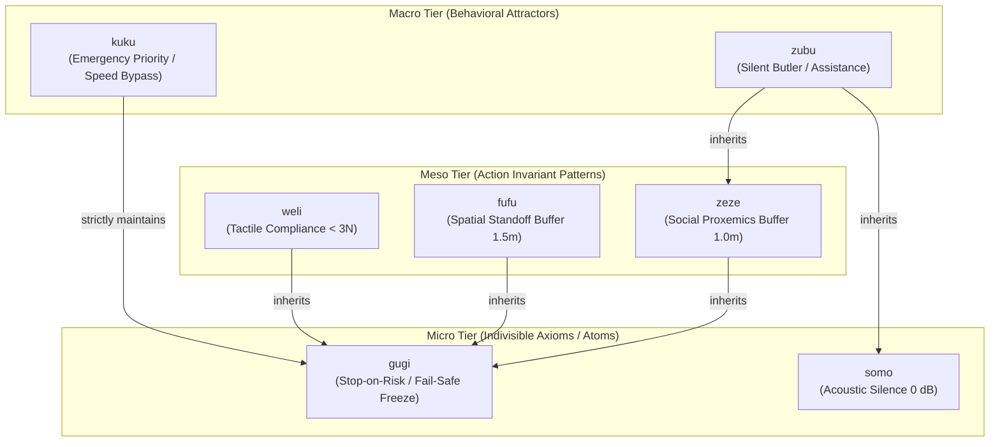

# Canonical Concept Catalog: Vocabulary v1.0

> **Document ID:** VOCAB-V1-001  
> **Project:** Lingual Composite Learning  
> **Principal Investigator:** Sebastian Oertel  
> **Status:** Formal Theoretical Specification (Work Package 3 from [`FOUNDATION_ROADMAP.md`](file:///c:/workspace/Experimental/LingualCompositLearning/dev/FOUNDATION_ROADMAP.md))  
> **Version Date:** November 01, 2026  

---

## 🗺️ 1. Hierarchical Architecture Overview

The vocabulary adheres to a strict 3-tier hierarchy. High-level macro roles inherit all behavioral invariants from subordinate concepts. Orthogonal concepts may be chained sequentially or composited ($C_A \cdot C_B$).

---

## 🔬 2. The Canonical Concept Catalog

### 2.1 Micro Tier (Atomic Axioms)

#### 1. `gugi` – The Fundamental Stop-on-Risk Axiom
- **Phonotactics:** Voiced plosive `/g/` + high back vowel `/u/` $\to$ sharp boundary, abrupt halt.
- **Semantic Axis:** $\mathcal{D}_{\text{risk}}$ (Epistemic safety and collision avoidance).
- **Trigger $\mathcal{T}_{\text{gugi}}$:** Detection of unverified obstacles within the safety envelope, trajectory ambiguity, or sensor degradation.
- **Hard Invariant $\mathcal{I}_{\text{gugi}}$:**
  $$\forall t: \text{Risk}(s_t) > \theta_{\text{safe}} \implies \mathbf{a}_t = \text{Freeze}() \quad (v = 0, \dot{v} = 0)$$
- **Audit Explanation:** *"Action suspended [gugi]: Immediate collision or physical instability risk detected."*

#### 2. `somo` – The Silence & Acoustic Damping Atom
- **Phonotactics:** Voiceless sibilant `/s/` + nasal `/m/` $\to$ quietude, closed-lip murmuring.
- **Semantic Axis:** $\mathcal{D}_{\text{social}}$ (Acoustic non-intrusiveness).
- **Trigger $\mathcal{T}_{\text{somo}}$:** Sleeping persons, active human conversations, quiet zones, libraries, clinical recovery wards.
- **Hard Invariant $\mathcal{I}_{\text{somo}}$:**
  $$\text{SoundEmission}(\mathbf{a}_t) \le L_{\text{ambient}} \quad \land \quad \text{MuteChimes}() = \text{True}$$
- **Audit Explanation:** *"Silent mode active [somo]: Acoustic emissions suppressed; all audible chimes muted."*

---

### 2.2 Meso Tier (Interaction & Material Handling Patterns)

#### 3. `fufu` – The Universal Spatial Standoff & Clearance Envelope
- **Phonotactics:** Voiceless labiodental fricative `/f/` $\to$ protective air corridor, buffer envelope.
- **Semantic Axis:** $\mathcal{D}_{\text{space}} \times \mathcal{D}_{\text{risk}}$ (Kinematic proximity & standoff).
- **Inheritance:** $\mathcal{I}_{\text{fufu}} \supseteq \mathcal{I}_{\text{gugi}}$ (subsumes fail-safe emergency stop).
- **Trigger $\mathcal{T}_{\text{fufu}}$:** Co-presence of vulnerable biological entities (infants, pets, frail elders) or tip-prone physical structures.
- **Hard Invariants $\mathcal{I}_{\text{fufu}}$:**
  1. Minimum standoff distance $d(\text{Agent}, \text{Vulnerable}) \ge 1.5\,\text{m}$.
  2. Velocity derating upon approach to crawl speed ($v \le 0.3\,\text{m/s}$).
  3. Wide detour around critical zones.
  4. Mandatory abort (`gugi`) if the safe navigation corridor is obstructed.
- **Audit Explanation:** *"Spatial envelope active [fufu]: 1.5m clearance buffer maintained around vulnerable entity."*

#### 4. `weli` – Tactile Compliance & Shear Protection
- **Phonotactics:** Labiovelar approximant `/w/` + liquid alveolar `/l/` $\to$ flow, compliance, elastic cushioning.
- **Semantic Axis:** $\mathcal{D}_{\text{force}} \times \mathcal{D}_{\text{risk}}$ (Compliance and contact force limitation).
- **Inheritance:** $\mathcal{I}_{\text{weli}} \supseteq \mathcal{I}_{\text{gugi}}$ (zero-force release upon excessive resistance).
- **Trigger $\mathcal{T}_{\text{weli}}$:** Manipulation of deformable, brittle, or living tissue (dough, crystal glass, parchment skin, optical fibers).
- **Hard Invariants $\mathcal{I}_{\text{weli}}$:**
  1. Maximum normal contact force $F_{\text{contact}} \le 3.0\,\text{N}$.
  2. Jerk-free force ramping ($\frac{dF}{dt} \le 1.0\,\text{N/s}$).
  3. Zero-impedance compliance (passive yielding) under external human counter-pressure.
- **Audit Explanation:** *"Tactile compliance active [weli]: Grip force limited to 3N; elastic yielding engaged."*

#### 5. `zeze` – The Personal Proxemic Zone
- **Phonotactics:** Voiced alveolar sibilant `/z/` $\to$ soft detour, respectful spacing.
- **Semantic Axis:** $\mathcal{D}_{\text{social}} \times \mathcal{D}_{\text{space}}$ (Social proxemics following E. T. Hall).
- **Inheritance:** $\mathcal{I}_{\text{zeze}} \supseteq \mathcal{I}_{\text{gugi}}$.
- **Trigger $\mathcal{T}_{\text{zeze}}$:** Shared workspaces, seated desk environments, confidential human exchanges.
- **Hard Invariants $\mathcal{I}_{\text{zeze}}$:**
  1. Respect personal proxemic buffer ($d \ge 1.0\,\text{m}$).
  2. Automatic retreat to room perimeter during confidential or sensitive situations.
- **Audit Explanation:** *"Proxemic buffer active [zeze]: Personal distance zone of 1.0m preserved."*

---

### 2.3 Macro Tier (Autonomous Behavioral Roles)

#### 6. `zubu` – The Silent Butler (Discreet Assistance)
- **Phonotactics:** Sibilant `/z/` + voiced bilabial stop `/b/` $\to$ discretion coupled with reliable presence.
- **Semantic Axis:** Unified synthesis across all 5 dimensions.
- **Inheritance:**
  $$\mathcal{I}_{\text{zubu}} = \mathcal{I}_{\text{zeze}} \cup \mathcal{I}_{\text{somo}} \cup \mathcal{I}_{\text{gugi}}$$
- **Trigger $\mathcal{T}_{\text{zubu}}$:** Board meetings, confidential negotiations, bedrooms, hospice settings.
- **Hard Invariants $\mathcal{I}_{\text{zubu}}$:**
  1. Silent execution (`somo`).
  2. 1.0m personal space buffer (`zeze`) with peripheral perimeter positioning.
  3. Eye contact restricted to direct human address.
  4. Suppression of all feedback chimes or unsolicited vocal confirmations.
- **Audit Explanation:** *"Butler role active [zubu]: Silent and non-intrusive peripheral co-presence."*

#### 7. `kuku` – Emergency Priority (Emergency Override)
- **Phonotactics:** Unvoiced velar stop `/k/` $\to$ urgency, decisive intervention.
- **Semantic Axis:** $\mathcal{D}_{\text{time}} \times \mathcal{D}_{\text{risk}}$.
- **Inheritance & Suspension:**
  - Social politeness (`zeze`, `somo`) is **temporarily suspended**.
  - **CRITICAL:** The fundamental collision-prevention axiom `gugi` remains **strictly active** (the agent will not collide with a human even during fire evacuation).
- **Trigger $\mathcal{T}_{\text{kuku}}$:** Structural fires, gas leaks, cardiac arrest AED delivery, evacuation alarms.
- **Hard Invariants $\mathcal{I}_{\text{kuku}}$:**
  1. Maximum rated transit velocity ($v = v_{\text{rated}}$).
  2. Direct Euclidean line-of-sight path (social clearance buffers bypassed).
  3. Hard fail-safe halt (`gugi`) if a human enters direct collision corridor.
- **Audit Explanation:** *"Emergency override active [kuku]: Maximum speed authorized; collision prevention maintained."*

---

## 🧩 3. Compositional Syntax Examples ($C_A \cdot C_B$)

- **`zubu · weli`:** *Serving delicate champagne flutes during an executive board meeting.*  
  $\to$ Silent locomotion (`zubu`) composited with $<3\,\text{N}$ tactile grip compliance (`weli`).
- **`fufu · weli`:** *Transferring a fragile infant or assisting an osteoporosis patient.*  
  $\to$ 1.5m spatial clearance against bumps (`fufu`) composited with compliant touch bedding (`weli`).
