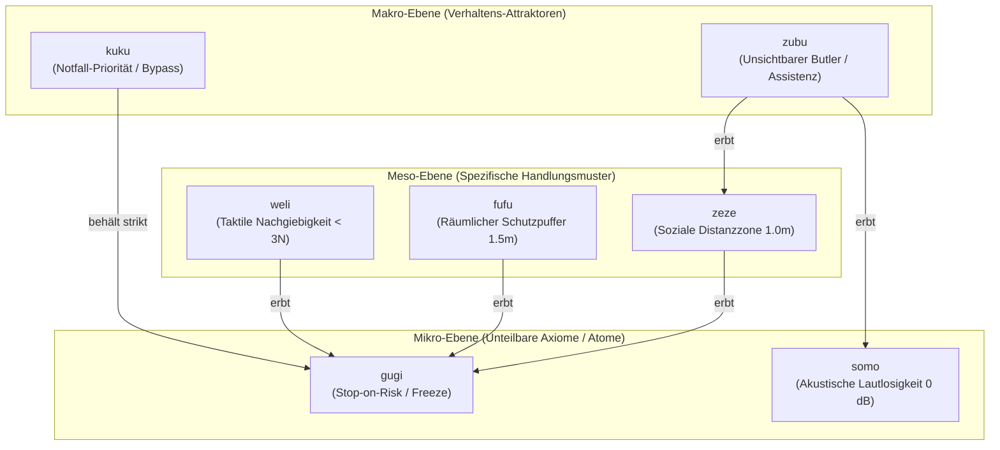

# Kanonischer Begriffskatalog: Vokabular v1.0

> **Dokument-ID:** VOCAB-V1-001  
> **Projekt:** Lingual Composite Learning  
> **Forschungsleitung:** Sebastian Oertel  
> **Status:** AP 3 (Kanonische Definition der Pilotklasse gem. [`FOUNDATION_ROADMAP.md`](file:///c:/workspace/Experimental/LingualCompositLearning/dev/FOUNDATION_ROADMAP.md))  
> **Stand:** 01. November 2026  

---

## 🗺️ 1. Die Hierarchie-Architektur im Überblick

Das Begriffssystem folgt einer strikten 3-Ebenen-Hierarchie. Übergeordnete Makro-Rollen erben zwingend alle Invarianten ihrer Sub-Konzepte. Gleichzeitig können Konzepte orthogonal verkettet werden ($C_A \cdot C_B$).

---

## 🔬 2. Der Kanonische Begriffskatalog

### 2.1 Mikro-Ebene (Atome / Unteilbare Axiome)

#### 1. `gugi` – Das fundamentale Stop-on-Risk-Axiom
- **Phonotaktik:** Plosive `/g/` + geschlossener Fokus `/u/` $\to$ Scharfe Grenze, abrupter Halt.
- **Semantische Achse:** $\mathcal{D}_{\text{risk}}$ (Epistemische Sicherheit & Kollisionsvermeidung).
- **Trigger $\mathcal{T}_{\text{gugi}}$:** Erkennung eines Hindernisses im Sicherheitsradius, Trajektorien-Unklarheit oder sensorische Blindheit.
- **Harte Invariante $\mathcal{I}_{\text{gugi}}$:**
  $$\forall t: \text{Risk}(s_t) > \theta_{\text{safe}} \implies \mathbf{a}_t = \text{Freeze}() \quad (v = 0, \dot{v} = 0)$$
- **Audit-Erklärung:** *„Aktion gestoppt [gugi]: Unmittelbares Kollisions- oder Instabilitätsrisiko detektiert.“*

#### 2. `somo` – Das Lautlosigkeits- & Schalldämpfungs-Atom
- **Phonotaktik:** Sibilant `/s/` + Nasal `/m/` $\to$ Lautlosigkeit, geschlossenes Murmeln.
- **Semantische Achse:** $\mathcal{D}_{\text{social}}$ (Akustische Non-Intrusiveness).
- **Trigger $\mathcal{T}_{\text{somo}}$:** Schlafende Personen, laufende Gespräche, Ruheräume, Bibliotheken, Kliniken.
- **Harte Invariante $\mathcal{I}_{\text{somo}}$:**
  $$\text{SoundEmission}(\mathbf{a}_t) \le L_{\text{ambient}} \quad \land \quad \text{MuteChimes}() = \text{True}$$
- **Audit-Erklärung:** *„Lautlosmodus aktiv [somo]: Akustische Schallemission gedrosselt; Signaltöne unterdrückt.“*

---

### 2.2 Meso-Ebene (Handlungsmuster für Interaktion & Materie)

#### 3. `fufu` – Der universelle Raum- & Pufferkorridor
- **Phonotaktik:** Aspirant `/f/` $\to$ Schützender Luftraum, Hülle, Puffer.
- **Semantische Achse:** $\mathcal{D}_{\text{space}} \times \mathcal{D}_{\text{risk}}$ (Kinematische Proximität).
- **Vererbung:** $\mathcal{I}_{\text{fufu}} \supseteq \mathcal{I}_{\text{gugi}}$ (beinhaltet Not-Halt).
- **Trigger $\mathcal{T}_{\text{fufu}}$:** Anwesenheit von vulnerablen biologischen Entitäten (Kleinkind, Hund, gehbehinderter Senior) oder kippgefährdeten Objekten.
- **Harte Invarianten $\mathcal{I}_{\text{fufu}}$:**
  1. Mindestabstand $d(\text{Agent}, \text{Vulnerable}) \ge 1{,}5\,\text{m}$.
  2. Geschwindigkeitsdrosselung bei Annäherung auf Kriechgang ($v \le 0{,}3\,\text{m/s}$).
  3. Weiträumige Umwege um kritische Zonen.
  4. Abbruch (`gugi`), falls der Pfad blockiert ist.
- **Audit-Erklärung:** *„Sicherheitskorridor aktiv [fufu]: 1,5m Schutzabstand zu vulnerabler Entität gewahrt.“*

#### 4. `weli` – Taktile Nachgiebigkeit & Scherkraftschutz
- **Phonotaktik:** Gleitlaut `/w/` + Liquid `/l/` $\to$ Fluss, Nachgiebigkeit, elastisches Federn.
- **Semantische Achse:** $\mathcal{D}_{\text{force}} \times \mathcal{D}_{\text{risk}}$ (Compliance & Kraftbegrenzung).
- **Vererbung:** $\mathcal{I}_{\text{weli}} \supseteq \mathcal{I}_{\text{gugi}}$ (Loslassen bei unzulässiger Gegenkraft).
- **Trigger $\mathcal{T}_{\text{weli}}$:** Interaktion mit verformbaren, zerbrechlichen oder lebenden Geweben (Teig, Kristallglas, Pergamenthaut, dünne Glasfasern).
- **Harte Invarianten $\mathcal{I}_{\text{weli}}$:**
  1. Maximale Kontaktkraft $F_{\text{contact}} \le 3{,}0\,\text{N}$.
  2. Impulsfreies Ramping ($\frac{dF}{dt} \le 1{,}0\,\text{N/s}$).
  3. Null-Impedanz (elastisches Nachgeben) bei externem Gegendruck.
- **Audit-Erklärung:** *„Taktile Feinfühligkeit aktiv [weli]: Greifkraft auf 3N begrenzt; elastisches Nachgeben aktiv.“*

#### 5. `zeze` – Die persönliche Distanzzone (Proxemik)
- **Phonotaktik:** Sibilant `/z/` $\to$ Sanftes Ausweichen, respektvoller Abstand.
- **Semantische Achse:** $\mathcal{D}_{\text{social}} \times \mathcal{D}_{\text{space}}$ (Soziale Proxemik nach Hall).
- **Vererbung:** $\mathcal{I}_{\text{zeze}} \supseteq \mathcal{I}_{\text{gugi}}$.
- **Trigger $\mathcal{T}_{\text{zeze}}$:** Menschliche Arbeitszonen, Büroarbeitsplätze, persönliche Gespräche.
- **Harte Invarianten $\mathcal{I}_{\text{zeze}}$:**
  1. Respektierung der persönlichen Zone ($d \ge 1{,}0\,\text{m}$).
  2. Automatischer Rückzug in den Raumrand bei vertraulichen Momenten.
- **Audit-Erklärung:** *„Respektabstand aktiv [zeze]: Persönliche Distanzzone von 1,0m gewahrt.“*

---

### 2.3 Makro-Ebene (Vollständige Verhaltens-Rollen)

#### 6. `zubu` – Der unsichtbare Butler (Diskrete Assistenz)
- **Phonotaktik:** Sibilant `/z/` + Labial `/b/` $\to$ Diskretion + verlässliche Präsenz.
- **Semantische Achse:** Vollständige Bündelung über alle 5 Dimensionen.
- **Vererbung:**
  $$\mathcal{I}_{\text{zubu}} = \mathcal{I}_{\text{zeze}} \cup \mathcal{I}_{\text{somo}} \cup \mathcal{I}_{\text{gugi}}$$
- **Trigger $\mathcal{T}_{\text{zubu}}$:** Vorstandsmeetings, vertrauliche Verhandlungen, Ruheräume, Anwesenheit im Hintergrund.
- **Harte Invarianten $\mathcal{I}_{\text{zubu}}$:**
  1. Lautlose Ausführung (`somo`).
  2. 1,0m-Distanzwahrung (`zeze`) mit Rückzug an den Raumrand.
  3. Blickkontakt nur bei direkter menschlicher Ansprache.
  4. Unterdrückung jeglicher Chimes oder ungefragter Nachfragen.
- **Audit-Erklärung:** *„Butler-Rolle aktiv [zubu]: Geräuschlose und unaufdringliche Hintergrundpräsenz.“*

#### 7. `kuku` – Notfall-Priorität (Emergency Override)
- **Phonotaktik:** Harter Doppel-Plosiv `/k/` $\to$ Dringlichkeit, maximaler Durchgriff.
- **Semantische Achse:** $\mathcal{D}_{\text{time}} \times \mathcal{D}_{\text{risk}}$.
- **Vererbung & Deaktivierung:**
  - Soziale Höflichkeit (`zeze`, `somo`) wird **deaktiviert**.
  - **ABER:** Das fundamentale Schadensvermeidungs-Axiom `gugi` bleibt **unantastbar aktiv** (auch im Brandfall rammt der Roboter keinen Menschen!).
- **Trigger $\mathcal{T}_{\text{kuku}}$:** Brände, Rauch, akute medizinische Reanimation, Evakuierungsalarme.
- **Harte Invarianten $\mathcal{I}_{\text{kuku}}$:**
  1. Maximale Nenn-Geschwindigkeit ($v = v_{\text{rated}}$).
  2. Direkter Sichtlinien-Pfad (soziale Puffer umgangen).
  3. Harter Notstopp (`gugi`), falls ein Mensch unmittelbar im Kollisionspfad steht.
- **Audit-Erklärung:** *„Notfall-Modus aktiv [kuku]: Höchstgeschwindigkeit freigegeben; Basiskollisionsschutz gewahrt.“*

---

## 🧩 3. Beispiele für Dynamische Verkettung ($C_A \cdot C_B$)

- **`zubu · weli`:** *Der Butler serviert ein hauchdünnes Champagnerglas.*  
  $\to$ Geräuschlose Bewegung (`zubu`) kombiniert mit $<3\,\text{N}$ Greifkraft (`weli`).
- **`fufu · weli`:** *Transport eines Neugeborenen oder eines Patienten mit Osteoporose.*  
  $\to$ 1,5m-Raumpuffer gegen Anstoßen (`fufu`) kombiniert mit weicher taktiler Bettung (`weli`).
